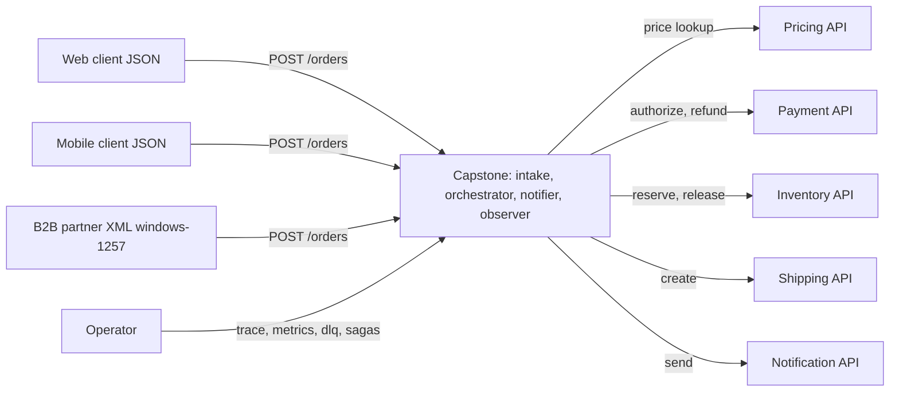
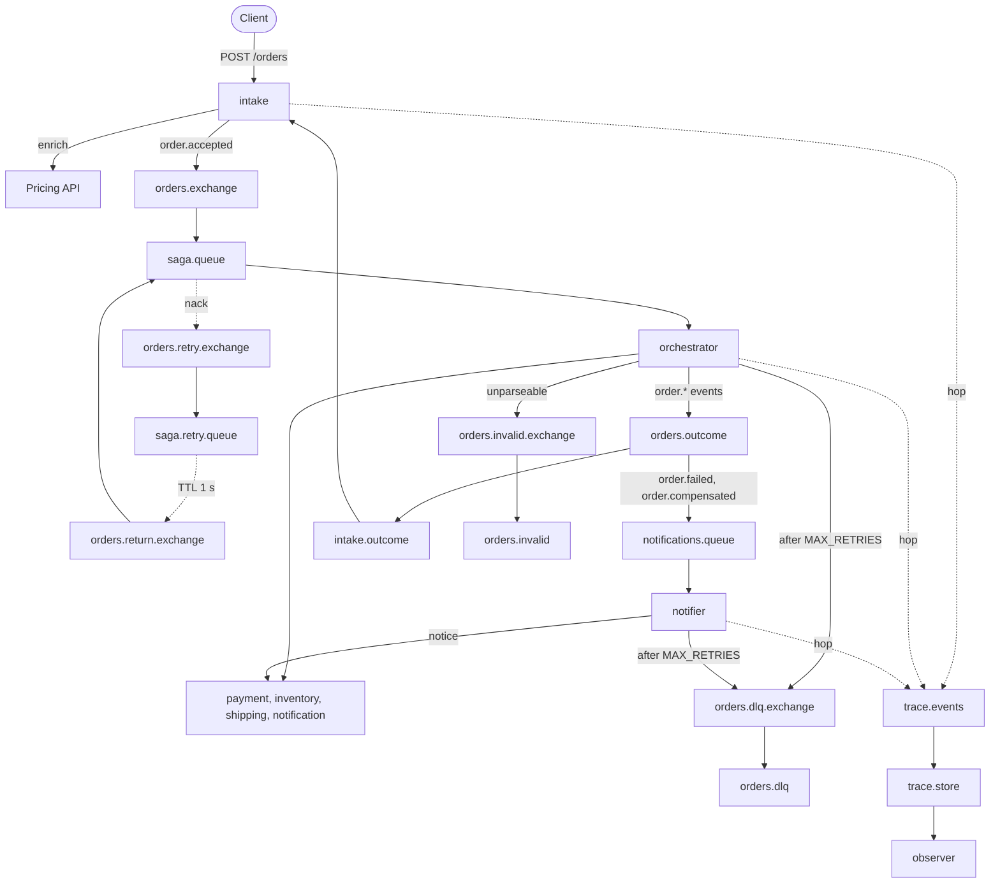

# Architecture

## System context

Orders arrive from three kinds of client, an operator watches the system, and the system calls five providers.

## Integration architecture

The solid arrows are the business flow; the dotted ones are the retry path (a nack goes through `orders.retry.exchange` into a one-second delay queue and back to `saga.queue`) and the wire tap into `trace.events`. The notifier has the same retry path through `notifications.retry.queue`.